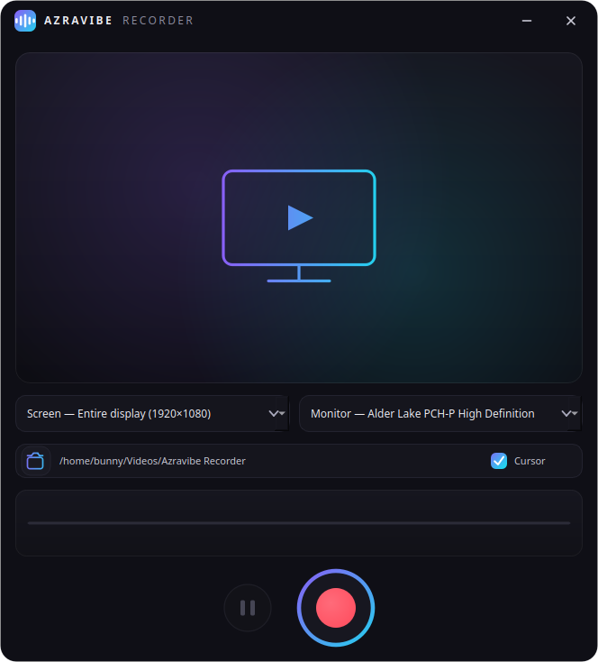

<div align="center">

# Azravibe Recorder
### Free, Open-Source 4K Screen Recorder for Linux (X11)

**The aesthetic, zero-bloat screen recorder for Linux that just works.**
Record your screen, any monitor, or any window — in crisp **4K UHD** with
real-time audio monitoring, a live waveform, hardware NVENC encoding and a
frameless, human-designed interface.



[](LICENSE)
[](CHANGELOG.md)
[](https://x.org/)
[](https://isocpp.org/)
[](https://www.qt.io/)
[](https://github.com/11nawid/azravibe-recorder/stargazers)
[](https://github.com/11nawid/azravibe-recorder/network/members)
[](CONTRIBUTING.md)

⭐ **If this helps you, tap the star — it genuinely helps the project grow.** ⭐

</div>

---

## Why another screen recorder?

Most Linux screen recorders are either Electron wrappers weighing half a
gigabyte, or two-knob CLI tools with no soul. **Azravibe Recorder is neither.**
It is a single native binary — C++17 + Qt 6 — that gives you a **beautiful,
productive** recording workflow in ~160 MB of RAM:

- 🎥 **Real 4K UHD (3840×2160)** recording with lanczos upscale, NVENC on your GPU
- 🌊 **Live, real audio waveform** — actual PCM peaks, not a fake animation
- 🖱️ **Cursor baked in** — pointer visible in recordings (toggle with ✓ Cursor)
- ⏸️ **Pause/Resume** — wall-clock timeline keeps audio & video perfectly in sync
- 🖥️ **Three capture targets** — entire display · per-monitor (RandR) · any window
- 🗂️ **Choose your output folder** — one glance shows exactly where files go
- 🔔 **Minimize keeps recording** — close the window, it never stops your capture
- 🚫 **Zero Electron, zero cloud, zero account** — completely local & private

### Keywords
`open source screen recorder` · `4k screen recorder linux` · `linux screencast` ·
`x11 screen recorder` · `ubuntu screen recorder` · `screen recorder linux mint` ·
`record desktop with audio` · `free screen recorder linux` · `c++ screen recorder` ·
`qt screen recorder` · `azravibe recorder`

---

## Quick start

```bash
git clone https://github.com/11nawid/azravibe-recorder.git
cd azravibe-recorder
make            # native build against your system Qt 6 & FFmpeg
./azravibe-recorder
```

**Requirements (Debian/Ubuntu/Mint):**

```bash
sudo apt install build-essential \
  qt6-base-dev libx11-dev libxext-dev libxrandr-dev libxfixes-dev \
  libavcodec-dev libavformat-dev libavutil-dev libswscale-dev libswresample-dev \
  libpulse-dev pkg-config
```

**Install it properly:**

```bash
make install    # ~/.local/bin/azravibe-recorder + icon + .desktop entry
```

> NVIDIA users: make sure your driver is current — `h264_nvenc` is auto-detected
> and used automatically; everything else falls back to libx264 with zero changes.

## Controls

| Control | Action |
|---|---|
| Record button | Start / stop recording |
| Pause button | Pause / resume (only while recording) |
| `Ctrl+R` / `Ctrl+Space` / `Ctrl+Q` | Record · Pause · Quit |
| Title bar **—** | Minimize (**recording continues**) |
| Title bar **✕** | Stop recording, finalize file, quit |

**Output:** `~/Videos/Azravibe Recorder/azravibe-YYYYMMDD-HHMMSS.mp4` (folder is
configurable in-app and persisted in `QSettings`).

## What it records

| Track | Codec | Container |
|---|---|---|
| Video | H.264 (NVENC or libx264), 3840×2160 | MP4 (faststart) |
| Audio | AAC 48 kHz stereo, 160 kbps | MP4 |

## Roadmap

- [ ] Wayland capture path (PipeWire ScreenCast portal)
- [ ] Global hotkeys for record/pause from anywhere
- [ ] Per-source gain & mic monitoring in the waveform
- [ ] Snapshot / GIF export buttons
- [ ] Localization (Persian, German, Spanish, …)

Have an idea? [Open an issue](https://github.com/11nawid/azravibe-recorder/issues) — PRs welcome.

## Support the project 💜

Azravibe Recorder is free and open source, built and maintained by one person.
If it saved your time:

- ⭐ **Star** this repo (it costs nothing, means a lot)
- 📣 **Share** it with friends, your Linux group, or on YouTube/Reddit
- ☕ **Help / donate / sponsor** — message me directly on Instagram:
  **[@1n1.nawid](https://www.instagram.com/1n1.nawid/)** or find me on GitHub:
  **[11nawid](https://github.com/11nawid)**

## Contributing

Read [CONTRIBUTING.md](CONTRIBUTING.md) — it covers the build, the smoke test
(`make smoke` — headless, writes a real .mp4), coding style and how to submit PRs.

## License

MIT — see [LICENSE](LICENSE). Do almost anything you want with it; attribution appreciated.

<sub>Keywords: azravibe-recorder · screen-recorder · linux · x11 · ubuntu · mint · 4k · nvenc · qt6 · c++ · ffmpeg · open-source</sub>
